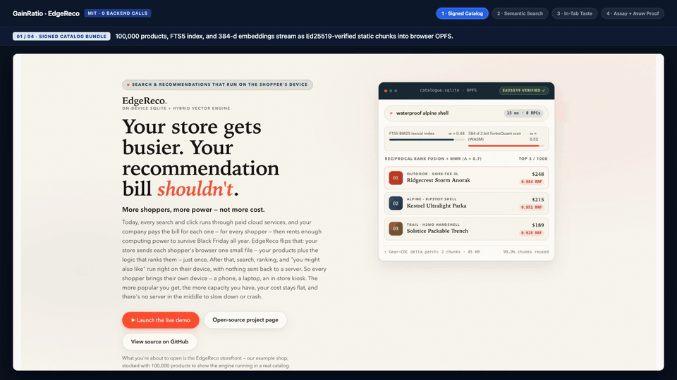
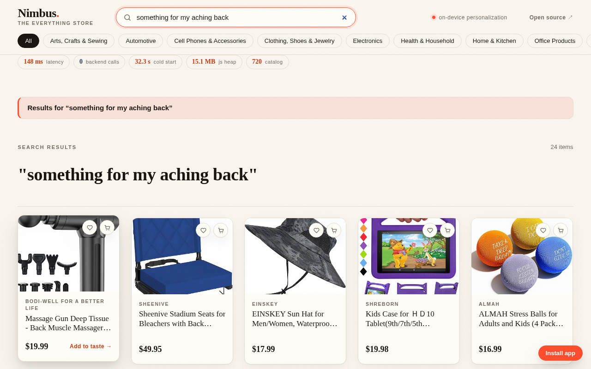

# EdgeReco

Search and product recommendations that run in each shopper's browser, not a paid server.

**[Try the demo store at edge-reco.com](https://edge-reco.com)**. Nothing to install.

[](https://github.com/gainratio/edge-reco/actions/workflows/dagger.yml)
[](LICENSE)

Most online stores rent their search box and their "you might also like" rows from a
cloud service that charges per search. The bill grows with traffic, and you pay for
enough capacity to survive your busiest day. Many small stores skip it and live with a
plain keyword search, which misses what shoppers mean: type "something for my aching
back" and it only finds products whose titles happen to contain the word "back".

EdgeReco does the searching and ranking inside the shopper's browser tab. Your store
publishes signed SQLite + 2-bit TurboQuant catalog bundles — 64 sharded IVF-TurboQuant
bundles (~79.0 MB signed bundle across 3,331 chunks behind a 96 KiB centroid router) in
the 1,000,000-product live storefront, or a single bundle for smaller catalogs. The browser
verifies every chunk, streams SQLite into OPFS (Origin Private File System, the browser's
private on-disk storage), searches by meaning as well as by words, and re-ranks
recommendations as the shopper clicks. No server answers the searches, so the application
and inference cost does not grow with traffic, and cached shards keep working offline.



**[Watch the 1080p walkthrough](https://open-source.gainratio.com/edge-reco/)** · **[Launch the live store](https://edge-reco.com)**

### Measured scale & retrieval quality (live storefront, Assay `trec_eval`)

| Metric | Measured value | Notes |
|---|---|---|
| Live catalog scale | **1,000,000 products** | 64 SQLite shards routed by a 96 KiB centroid table (`adaptive nprobe = 1..3`, cosine margin `0.14`) |
| Signed bundle / delta size | **~79.0 MB** full / **~42.9 KB** delta | 3,331 content-addressed chunks; price updates download only 2 changed chunks |
| Backend search & reco calls | **0** | Hybrid FTS5 BM25 + 2-bit TurboQuant MiniLM-L6-v2 runs in a browser Web Worker + OPFS |
| Precision@10 (`natural`, 31 queries) | **97.4%** | 2:1 semantic-over-lexical Reciprocal Rank Fusion (`RRF`) |
| nDCG@10 / MRR | **0.974** / **0.984** | 95% bootstrap CI `[0.937, 1.000]` |
| Recall@24 (ceiling-normalized) | **94.0%** (`50.8%` raw / `54.1%` k=24 oracle max) | `0.636` F1@24 (`93.6%` of `0.680` oracle ceiling) |

**Technical docs:** [Architecture](docs/ARCHITECTURE.md) · [Getting started for developers](docs/GETTING_STARTED.md) · [Python library and CLI](docs/USAGE.md) · [Security and privacy](docs/SECURITY-PRIVACY.md) · [Deploy](docs/DEPLOY.md)

## The Black Friday problem

A recommendation row is cheap per shopper and brutal at peak. On Black Friday, traffic
can multiply while every product page still asks for "recommended for you", "customers
also bought", and search-as-you-type. A hosted search or recommendation service charges
per request and has to be provisioned for the busiest hour; inference capacity sits idle
most of the year, then becomes the bottleneck exactly when revenue is concentrated.

EdgeReco moves that work to the shopper's device. The catalog and ranking data are
signed static assets served by a CDN. The browser downloads them once, verifies them,
and runs search and re-ranking locally. The retailer pays **no per-query application or
inference cost**; a traffic spike adds CDN bytes and uses the shopper's own CPU, not a
queue of API calls or servers sized for the worst hour.

For a Fortune 500 catalog, that is an **offload layer**: keep the systems of record,
pricing, and checkout in the cloud, but stop paying per recommendation and stop making
the recommendation service the scaling bottleneck. Every shopper uses the same signed
bundle; a price change ships as a few changed chunks.

Illustratively, if a store serves `N` shoppers with `R` recommendation requests each and
its vendor charges `p` per request, the hosted bill is roughly `N × R × p`. EdgeReco
replaces that with a bundle download per new device plus CDN egress; after the bundle is
cached, another request adds no server work. Plug in your own vendor price — the point is
the shape, not a quoted rate.

This is not a replacement for a ten-million-item merchandising platform. It is an edge
tier for catalogs up to 1,000,000 SKUs and for the high-volume rows where per-request
pricing hurts most.

## Try it

1. Open [edge-reco.com](https://edge-reco.com) and click **Launch the live demo**. This
   opens the EdgeReco demo store with 1,000,000 products across 12 departments. The
   first launch syncs the centroid router and home shard into OPFS, fetches probed shards
   on demand, and loads the small language model on the first semantic search, so give it
   a moment. Later visits start from the copy in your browser.
2. Type `something for my aching back` in the search box and press Enter.



A neck and back massager comes first, then a stadium seat with back support. Only three
products come back, because nothing else in the store is a good match. The strip under
the search box shows `0 backend calls`: the search ran in your tab. Its other
numbers (search time, start-up time, memory) are measured live on your machine and vary.

3. Click the heart or the cart button on the massager. Scroll down to **Recommended
   for you**. The counter next to it goes to 1, then 2 signals, and the row re-orders
   toward the massager's category (Health & Household). Those signals are saved only in
   your browser. **Reset taste** clears them.
4. Click **⚡ Apply delta** in the top metrics bar to simulate a live price update.
   Because each catalog shard ships as a page-aligned SQLite database split into
   content-addressed chunks, your browser downloads only the 2 changed chunks (about
   43 KB) and reuses the other 3,329 chunks from its local cache — updating prices in
   place without reloading the page or the language model.

## How it works

The store builds its catalog once: a prebuilt SQLite database (`catalogue.sqlite`) holding
the products, FTS5 keyword index, and quantized 384-d `sqlite-vector` embeddings, plus the
ranking weights. It signs that bundle with a private key. The shopper's
browser downloads the bundle, checks every piece against a public key built into the app,
and refuses to load anything that does not match. When products or prices change, the
browser compares the new signed manifest against its cached chunks, downloads only the
changed SQLite pages, and swaps the catalog in place. After that, each search runs a
keyword match and a meaning match side by side inside SQLite, merges the two lists, and
re-orders the result using what this shopper has clicked.

## Your data stays on your device

No user data leaves the device. What you click, view, favorite or add to the cart is
stored only in a SQLite database inside your own browser, and nothing is sent to or
stored on any server or cloud. The data is yours. Wipe it with **Reset taste** or by
clearing the site's data in your browser. There is no export/import yet.

If your browser won't let the tab keep a database (private mode, or the store is open in
another tab), the store still works but forgets your activity on reload, and a note at
the top says so.

EdgeReco is built on three sibling projects by the same author:

- [edgeproc-browser](https://github.com/gainratio/edgeproc-browser) (`@gainratio/browser`)
  does the download, signature check and offline storage in the browser.
- [edge-proc](https://github.com/gainratio/edge-proc) does the same job for the optional
  Python side: it publishes and syncs the signed catalog, and searches it on a server.
- [edgeproc-core](https://github.com/gainratio/edgeproc-core) is a small Python library
  edge-proc uses to organise its search index.

EdgeReco adds the store-specific part: the ranking formula, the shopper's session
signals and the demo store. [privacy-core](https://github.com/gainratio/privacy-core) is
a separate, unrelated project (it hides personal data in AI prompts).

## What it does not do

- **Ten-million-item catalogs.** Sharded IVF-TurboQuant mode partitions 1,000,000
  products across 64 SQLite shards routed by a 96 KiB centroid table in the live demo —
  not tens of millions of items.
- **Private catalogs.** Every shopper can download the catalog shards, so anything in the
  catalog is public.
- **Private Browsing / disabled local storage.** The live demo streams its home catalog
  shard into a file-backed OPFS SQLite database (~24 MB model on first semantic search)
  and probes extra shards in bounded worker memory so usage stays predictable on phones
  and desktops; Private Browsing blocks OPFS and displays a warning to reopen in a normal
  tab.
- **A hosted service.** You build the catalog and host the static files yourself.
- **Merchandising tools.** There is no dashboard, A/B testing or manual boosting. Ranking
  is tuned by editing weights in the signed catalog.
- **Proof of each result.** The "why?" panel shows how a score was calculated and checks
  that the ranking settings were signed. It does not prove that a specific displayed
  result came from those settings.

## When to use something else

| If you need | Use |
| --- | --- |
| Tens of millions of products, merchandising tools, and a vendor who runs it | A hosted search and recommendation service |
| Shoppers who search by exact product names only | Your store platform's built-in search |
| A catalog that must stay private | Your own search server behind an API |
| Up to ~1,000,000 products, flat cost, offline use, nothing to run per search | EdgeReco |
| A Fortune 500 peak-traffic offload tier in front of an existing catalog | EdgeReco for the high-volume rows; keep the system of record hosted |

## Run it yourself

You need Node 24.16 (see [`frontend/.nvmrc`](frontend/.nvmrc)) and pnpm, which
`corepack` provides.

```bash
git clone https://github.com/gainratio/edge-reco
cd edge-reco/frontend
corepack enable
pnpm install
pnpm -F frontend run build:pages
pnpm -F frontend exec vite preview
```

Open http://localhost:4173 and click **Launch the live demo**. On a fresh clone the
install took 12 seconds and the build 17 seconds. The build downloads the language model
and its runtime once and checks each against a pinned fingerprint.

The optional Python library, command line tool and API server need Python 3.13 and
[uv](https://docs.astral.sh/uv/). See [docs/USAGE.md](docs/USAGE.md).

## Under the hood (for developers)

- **Pre-quantized 2-bit TurboQuant & 1M IVF sharding (`backend/` + `edge-proc`).** The offline builder compiles products, an FTS5 BM25 keyword index, and pre-populated 2-bit TurboQuant 384-d shadow rows (`vector0_products_embedding` at 108 B/row, stripping raw float32 vectors via `zeroblob(0)`) into SQLite — either a single `catalogue.sqlite` up to 100,000 products or 64 spherical k-means IVF shards (~1.9 MB zstd per shard + 96 KiB `centroids.f32`) up to 1,000,000 products — and signs the manifest with Ed25519.
- **OPFS streaming & binary delta updates (`@gainratio/browser` + `edge-proc`).** Inside a dedicated Web Worker, the browser checks the Ed25519 signature and every digest before writing SQLite pages into OPFS; when prices or products change, clients either fetch modified content-addressed chunks or apply prebuilt `zstd --patch-from` binary delta patches (~9.4 KB for a 1%-updated shard).
- **Hybrid retrieval, Reciprocal Rank Fusion, MMR & Assay quality checks (`frontend/` + `backend/`).** Each query runs lexical BM25 (`FTS5`) alongside semantic MiniLM-L6-v2 (`onnxruntime-web` WASM) vector similarity (routing across top `nprobe` IVF centroids via `rankIvfCentroids` on sharded catalogs), merges candidates with Reciprocal Rank Fusion (`RRF`), diversifies results with Maximal Marginal Relevance (`MMR`), combines shopper session signals through `@gainratio/assay`, and verifies held-out precision, recall, F1, nDCG, and MRR floors in CI with `assay-engine` (`trec_eval`).

## Develop

```bash
make gate
```

This runs the backend checks (`poe gate`) and the frontend checks (`pnpm gate`), the same
as CI. Allow about 8 minutes. [docs/GETTING_STARTED.md](docs/GETTING_STARTED.md) takes a
new developer from a fresh clone to a green build and a first change, including the
local traps to know about. Also see [CONTRIBUTING.md](CONTRIBUTING.md).

## More detail

- [Getting started for developers](docs/GETTING_STARTED.md): setup, the full check, a map
  of the code, and a first change.
- [Architecture](docs/ARCHITECTURE.md): the pieces, the scoring formula, how the browser
  and Python engines are kept in step, the security model, and what the tests prove.
- [Explore the interactive architecture map](docs/architecture/index.html): the runtime
  flow in an offline viewer.
- [Python library and CLI](docs/USAGE.md): run the same search in Python, tune the
  ranking weights, the command line, and configuration.
- [Quickstart](docs/QUICKSTART.md): the longer walkthrough, including `make demo` with
  Docker and building a catalog from your own CSV.
- [Deploy](docs/DEPLOY.md): hosting as static files, and the server-backed variant.
- [Security and privacy](docs/SECURITY-PRIVACY.md): the threat model and what data goes
  where. Report vulnerabilities as described in [SECURITY.md](SECURITY.md).
- [Dagger CI setup](docs/dagger-lego-adoption.md): how the CI pipeline is built and
  shared with other repositories.
- [CHANGELOG](CHANGELOG.md): what changed in each release.

## License

MIT. See [LICENSE](LICENSE). Demo data: Synthetic demo catalog generated by backend/scripts/generate_catalog.py (MIT). Every brand and product in it is invented.
Details in [NOTICE](NOTICE).
